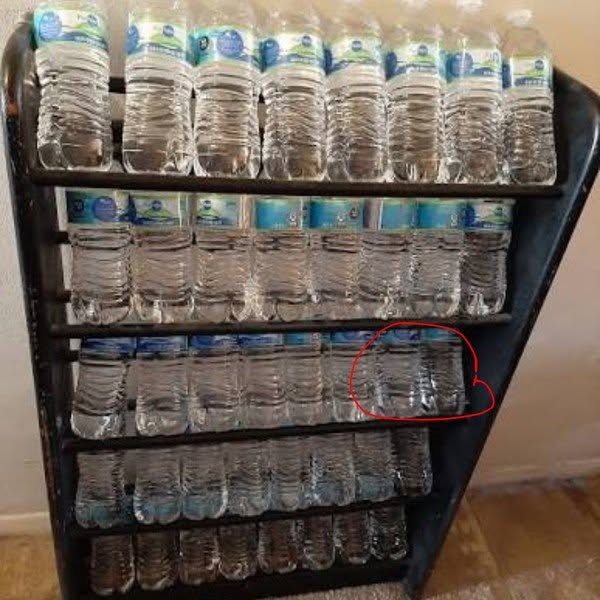

# 090 · Ready Nation USA

- **Anuncio original:** [Meta · 1387530530016970](https://www.facebook.com/ads/library/?id=1387530530016970)
- **Página anunciante:** Ready Nation USA · 1108073152395957
- **Destino observado:** [guardsurvival.com](https://guardsurvival.com/products/aqua-gs1)
- **Categoría:** Hogar y preparación
- **Inicio publicado:** 2026-08-28 · 34 días de antigüedad.
- **Activo al consultar:** 2026-10-01T14:24:53.328Z.
- **Ads activos globales de esa página:** aprox. 2800 · [fuente](https://www.facebook.com/ads/library/?active_status=active&ad_type=all&country=ALL&media_type=all&search_type=page&view_all_page_id=1108073152395957).
- **Consulta geográfica:** [Estados Unidos](https://www.facebook.com/ads/library/?active_status=active&ad_type=all&country=US&is_targeted_country=false&media_type=image&search_type=page&sort_data[mode]=total_impressions&sort_data[direction]=desc&view_all_page_id=1108073152395957).
- **Longitud del texto original:** 1986 palabras; el resumen de abajo es propio.

## Apertura breve del anuncio

> Something happened yesterday that changes what your family needs to do this week. Most people scrolled

## Qué desarrolla el copy

Una noticia y una operación geopolítica supuestamente descubierta por el narrador abren una investigación personal. El texto encadena combustible, electricidad y agua doméstica para presentar el filtro Aqua-GS1 como respuesta. Repite el motivo de seguir una gran noticia hasta la cocina del lector; sus hechos y amenazas no fueron corroborados.

## Qué muestra la imagen

Estantería con botellas de agua dentro de una habitación y un pequeño círculo rojo que llama la atención sobre ellas.

## Por qué encaja en el formato nativo

Escena u objeto del entorno cotidiano, presentado como observación personal y acompañado de un relato extenso. No usa un banner de oferta; la autenticidad de la historia no está comprobada. Las marcas rojas funcionan como llamada editorial de atención y no como placa comercial.

## Cómo adaptar la idea

Partir de un aviso real y fechado de un servicio local, explicar sus implicaciones prácticas y demostrar qué resuelve el producto. Separar las capacidades certificadas de cualquier hipótesis de crisis.

## Alcance de la verificación

Actividad, fecha publicada, consulta US, conteo de la página y formato revisados. No se verificó entrega continua, rentabilidad, autoría del testimonio ni los resultados que anuncia. El dominio de destino no demuestra propiedad de la página. Sin desglose de placements conservado: se verificó la consulta Meta para Estados Unidos.
