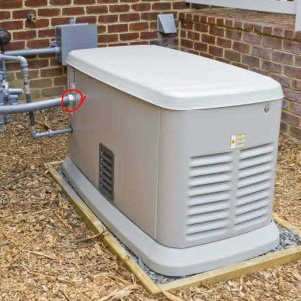

# 092 · Ready Nation USA

- **Anuncio original:** [Meta · 1071081202520410](https://www.facebook.com/ads/library/?id=1071081202520410)
- **Página anunciante:** Ready Nation USA · 1108073152395957
- **Destino observado:** [guardsurvival.com](https://guardsurvival.com/pages/advertorial-v1-guard-survival)
- **Categoría:** Hogar y preparación
- **Inicio publicado:** 2026-08-28 · 34 días de antigüedad.
- **Activo al consultar:** 2026-10-01T14:24:53.328Z.
- **Ads activos globales de esa página:** aprox. 2800 · [fuente](https://www.facebook.com/ads/library/?active_status=active&ad_type=all&country=ALL&media_type=all&search_type=page&view_all_page_id=1108073152395957).
- **Consulta geográfica:** [Estados Unidos](https://www.facebook.com/ads/library/?active_status=active&ad_type=all&country=US&is_targeted_country=false&media_type=image&search_type=page&sort_data[mode]=total_impressions&sort_data[direction]=desc&view_all_page_id=1108073152395957).
- **Longitud del texto original:** 1687 palabras; el resumen de abajo es propio.

## Apertura breve del anuncio

> Federal experts — not conspiracy theorists, not survivalists, not influencers — FEDERAL EXPERTS said a coordinated

## Qué desarrolla el copy

Abre atribuyendo a expertos federales la posibilidad de un apagón extremadamente prolongado. Luego recorre límites de reservas y equipamiento doméstico para concluir que el hogar necesita una solución autónoma de agua, presentada como Aqua-GS1. La duración y la atribución a autoridades son afirmaciones del anunciante, no hechos comprobados en esta investigación.

## Qué muestra la imagen

Generador exterior claro, instalado sobre una base al lado de una pared de ladrillos.

## Por qué encaja en el formato nativo

Escena u objeto del entorno cotidiano, presentado como observación personal y acompañado de un relato extenso. No usa un banner de oferta; la autenticidad de la historia no está comprobada.

## Cómo adaptar la idea

Presentar un escenario razonable de preparación apoyado en guías oficiales y mostrar límites reales del equipo. No usar cifras extremas atribuidas a autoridades sin una fuente comprobable.

## Alcance de la verificación

Actividad, fecha publicada, consulta US, conteo de la página y formato revisados. No se verificó entrega continua, rentabilidad, autoría del testimonio ni los resultados que anuncia. El dominio de destino no demuestra propiedad de la página. Sin desglose de placements conservado: se verificó la consulta Meta para Estados Unidos.
