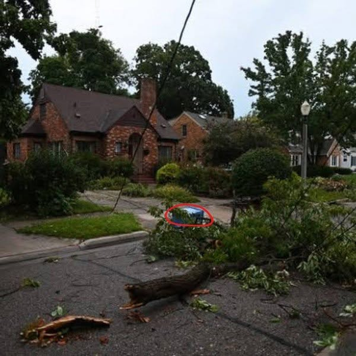

# 094 · Ready Nation USA

- **Anuncio original:** [Meta · 1295652169188935](https://www.facebook.com/ads/library/?id=1295652169188935)
- **Página anunciante:** Ready Nation USA · 1108073152395957
- **Destino observado:** [guardsurvival.com](https://guardsurvival.com/pages/advertorial-v1-guard-survival)
- **Categoría:** Hogar y preparación
- **Inicio publicado:** 2026-08-28 · 34 días de antigüedad.
- **Activo al consultar:** 2026-10-01T14:24:53.328Z.
- **Ads activos globales de esa página:** aprox. 2800 · [fuente](https://www.facebook.com/ads/library/?active_status=active&ad_type=all&country=ALL&media_type=all&search_type=page&view_all_page_id=1108073152395957).
- **Consulta geográfica:** [Estados Unidos](https://www.facebook.com/ads/library/?active_status=active&ad_type=all&country=US&is_targeted_country=false&media_type=image&search_type=page&sort_data[mode]=total_impressions&sort_data[direction]=desc&view_all_page_id=1108073152395957).
- **Longitud del texto original:** 1538 palabras; el resumen de abajo es propio.

## Apertura breve del anuncio

> A city in Indiana has been without power for two weeks. Not from a hurricane. Not

## Qué desarrolla el copy

Usa un supuesto apagón prolongado en Indiana como caso narrativo de deterioro cotidiano: alimentos, escuela y necesidades del hogar. Una consulta familiar conduce al problema del agua y al filtro Aqua-GS1. Las cifras, duración y escenas de la emergencia son afirmaciones no corroboradas del anuncio.

## Qué muestra la imagen

Calle residencial de día con ramas y restos de árboles caídos frente a las casas.

## Por qué encaja en el formato nativo

Fotografía de apariencia periodística o documental, sin precio ni diseño de banner dominante; el texto largo desarrolla una historia hasta la oferta. La imagen no acredita los hechos narrados.

## Cómo adaptar la idea

Elegir un incidente real de suministro, documentar lo ocurrido y explicar límites y certificaciones de la solución. Usar fotos autorizadas del contexto y evitar cifras o testimonios sin respaldo.

## Alcance de la verificación

Actividad, fecha publicada, consulta US, conteo de la página y formato revisados. No se verificó entrega continua, rentabilidad, autoría del testimonio ni los resultados que anuncia. El dominio de destino no demuestra propiedad de la página. Misma foto que 2197870777777830, con un argumento de copy diferente; se conserva como variante creativa. Sin desglose de placements conservado: se verificó la consulta Meta para Estados Unidos.
