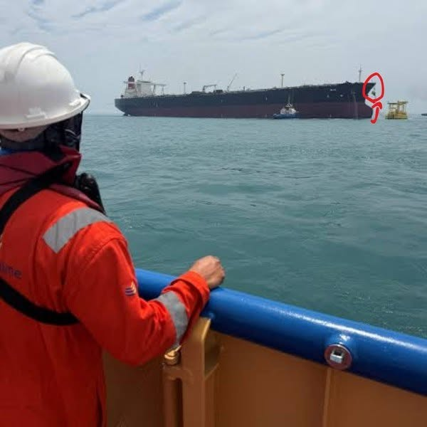

# 097 · Ready Nation USA

- **Anuncio original:** [Meta · 1402515568646739](https://www.facebook.com/ads/library/?id=1402515568646739)
- **Página anunciante:** Ready Nation USA · 1108073152395957
- **Destino observado:** [guardsurvival.com](https://guardsurvival.com/pages/advertorial-v1-guard-survival)
- **Categoría:** Hogar y preparación
- **Inicio publicado:** 2026-08-28 · 34 días de antigüedad.
- **Activo al consultar:** 2026-10-01T14:24:53.328Z.
- **Ads activos globales de esa página:** aprox. 2800 · [fuente](https://www.facebook.com/ads/library/?active_status=active&ad_type=all&country=ALL&media_type=all&search_type=page&view_all_page_id=1108073152395957).
- **Consulta geográfica:** [Estados Unidos](https://www.facebook.com/ads/library/?active_status=active&ad_type=all&country=US&is_targeted_country=false&media_type=image&search_type=page&sort_data[mode]=total_impressions&sort_data[direction]=desc&view_all_page_id=1108073152395957).
- **Longitud del texto original:** 1401 palabras; el resumen de abajo es propio.

## Apertura breve del anuncio

> I've sailed through the Strait of Hormuz fourteen times in my career. Yesterday I was handed

## Qué desarrolla el copy

Un narrador que se presenta como capitán relata una ruta marítima presuntamente peligrosa y una conversación con su pareja. Del riesgo de transporte pasa a combustible, energía y agua en el hogar, donde sitúa el filtro Aqua-GS1 como respuesta. La profesión, el viaje y las amenazas son elementos del relato del anunciante, sin comprobación independiente.

## Qué muestra la imagen

Persona con casco y ropa naranja observa desde una embarcación un carguero lejano; una señal roja destaca parte del fondo.

## Por qué encaja en el formato nativo

Fotografía de apariencia periodística o documental, sin precio ni diseño de banner dominante; el texto largo desarrolla una historia hasta la oferta. La imagen no acredita los hechos narrados. Las marcas rojas funcionan como llamada editorial de atención y no como placa comercial.

## Cómo adaptar la idea

Una persona con experiencia real puede explicar cómo una interrupción afectó su trabajo y qué aprendió. Vincularlo a una solución demostrable sin inventar rutas peligrosas, minas ni avisos reservados.

## Alcance de la verificación

Actividad, fecha publicada, consulta US, conteo de la página y formato revisados. No se verificó entrega continua, rentabilidad, autoría del testimonio ni los resultados que anuncia. El dominio de destino no demuestra propiedad de la página. Sin desglose de placements conservado: se verificó la consulta Meta para Estados Unidos.
