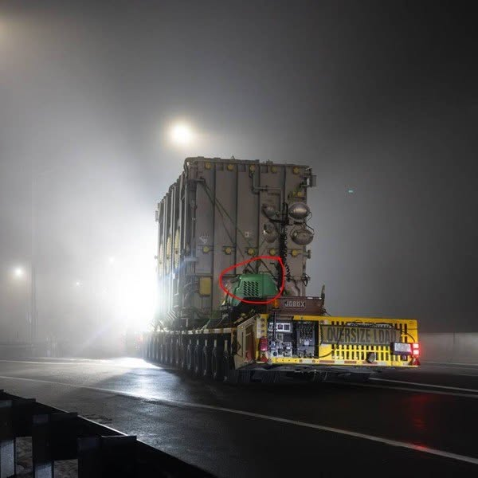

# 100 · Ready Nation USA

- **Anuncio original:** [Meta · 2086333945292378](https://www.facebook.com/ads/library/?id=2086333945292378)
- **Página anunciante:** Ready Nation USA · 1108073152395957
- **Destino observado:** [guardsurvival.com](https://guardsurvival.com/pages/radio)
- **Categoría:** Hogar y preparación
- **Inicio publicado:** 2026-08-29 · 33 días de antigüedad.
- **Activo al consultar:** 2026-10-01T14:24:53.328Z.
- **Ads activos globales de esa página:** aprox. 2800 · [fuente](https://www.facebook.com/ads/library/?active_status=active&ad_type=all&country=ALL&media_type=all&search_type=page&view_all_page_id=1108073152395957).
- **Consulta geográfica:** [Estados Unidos](https://www.facebook.com/ads/library/?active_status=active&ad_type=all&country=US&is_targeted_country=false&media_type=image&search_type=page&sort_data[mode]=total_impressions&sort_data[direction]=desc&view_all_page_id=1108073152395957).
- **Longitud del texto original:** 1801 palabras; el resumen de abajo es propio.

## Apertura breve del anuncio

> Something happened yesterday that changes what your family needs to do this week. Most people scrolled

## Qué desarrolla el copy

Parte de una noticia supuestamente decisiva y del narrador que sigue sus consecuencias hasta el hogar. El recorrido termina en el riesgo de perder comunicaciones cuando fallen la red y el teléfono, y vende una radio de emergencia. Comparte la fotografía y el arranque del anuncio del filtro, pero cambia de producto y argumento central.

## Qué muestra la imagen

El mismo camión nocturno con gran carga industrial del candidato 8; este anuncio usa un argumento y producto diferentes.

## Por qué encaja en el formato nativo

Fotografía de apariencia periodística o documental, sin precio ni diseño de banner dominante; el texto largo desarrolla una historia hasta la oferta. La imagen no acredita los hechos narrados. Las marcas rojas funcionan como llamada editorial de atención y no como placa comercial.

## Cómo adaptar la idea

Usar una interrupción real y documentada para explicar cómo obtener avisos oficiales sin internet. Mostrar una prueba funcional de la radio y canales disponibles en la zona, sin noticias fabricadas.

## Alcance de la verificación

Actividad, fecha publicada, consulta US, conteo de la página y formato revisados. No se verificó entrega continua, rentabilidad, autoría del testimonio ni los resultados que anuncia. El dominio de destino no demuestra propiedad de la página. Sin desglose de placements conservado: se verificó la consulta Meta para Estados Unidos.
