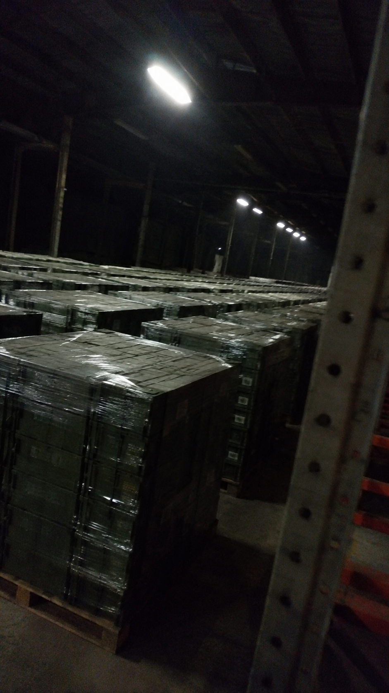

# 025 · Rivanta Power

- **Anuncio original:** [Meta · 1365667822355028](https://www.facebook.com/ads/library/?id=1365667822355028)
- **Página anunciante:** Rivanta Power · 891443974046368
- **Destino observado:** [go.tryrivanta.com](https://go.tryrivanta.com/cmq7inspk0004s561tqu5n22v)
- **Categoría:** Hogar y preparación
- **Inicio publicado:** 2026-07-23 · 70 días de antigüedad.
- **Activo al consultar:** 2026-10-01T14:12:05.912606+00:00.
- **Ads activos globales de esa página:** aprox. 540 · [fuente](https://www.facebook.com/ads/library/?active_status=active&ad_type=all&country=ALL&is_targeted_country=false&media_type=all&search_type=page&view_all_page_id=891443974046368).
- **Consulta geográfica:** [Estados Unidos](https://www.facebook.com/ads/library/?active_status=active&ad_type=all&country=US&media_type=image&q=my+wife&search_type=keyword_unordered).
- **Longitud del texto original:** 824 palabras; el resumen de abajo es propio.

## Apertura breve del anuncio

> I spent eight years inside Iran pretending to be one of them. I spoke Farsi

## Qué desarrolla el copy

Voz de un supuesto exoperativo de inteligencia que usa una historia sobre Irán y ataques a infraestructura para generar preocupación, luego presenta un power bank Rivanta con funciones y garantía. Identidad, historia y amenazas no verificadas.

## Qué muestra la imagen

Foto vertical oscura del interior de un almacén o nave, con pilas de cajas y luminarias en el techo; encuadre imperfecto y sin texto.

## Por qué encaja en el formato nativo

Estética documental de un lugar real, sin packshot aislado, precio ni llamada de venta sobre la imagen.

## Cómo adaptar la idea

Usar un escenario real de cortes de energía y una demostración práctica de autonomía con datos comprobados. Evitar relatos de espionaje, alarmas geopolíticas o escasez inventados.

## Alcance de la verificación

Actividad, fecha publicada, consulta US, conteo de la página y formato revisados. No se verificó entrega continua, rentabilidad, autoría del testimonio ni los resultados que anuncia. El dominio de destino no demuestra propiedad de la página. 
