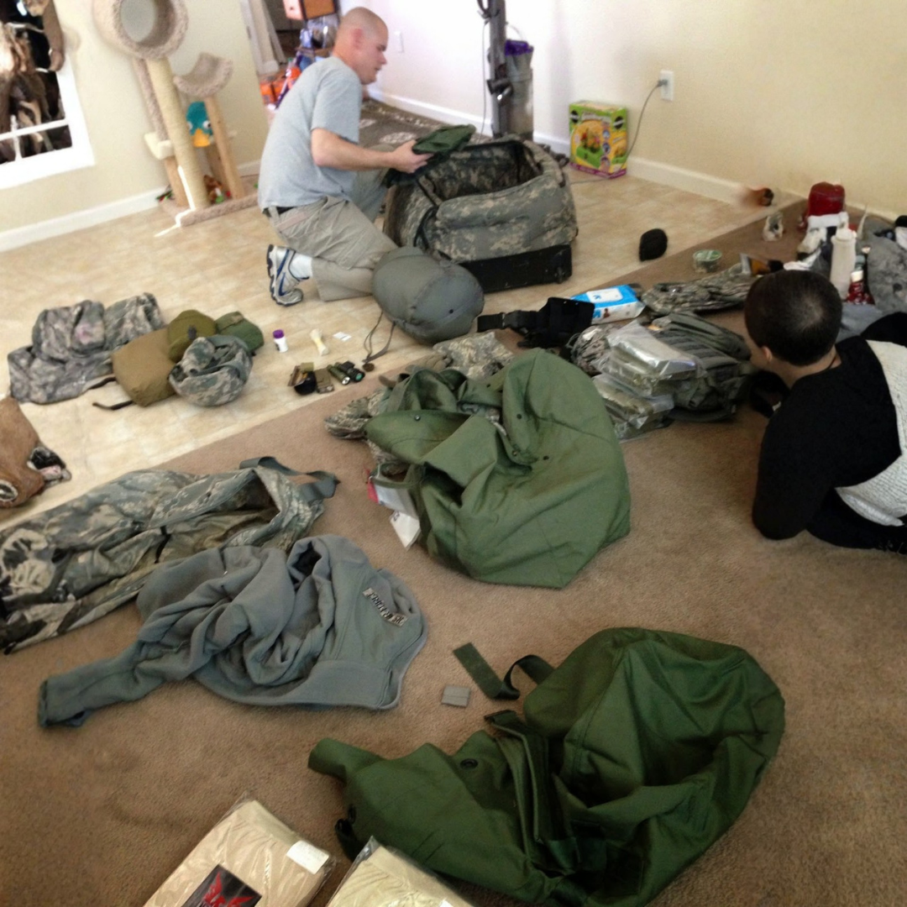

# 026 · USA Ready Families

- **Anuncio original:** [Meta · 1426901325854608](https://www.facebook.com/ads/library/?id=1426901325854608)
- **Página anunciante:** USA Ready Families · 1003452056175880
- **Destino observado:** [primitivelabsresearch.com](https://primitivelabsresearch.com/products/hydra-x1-portable-filtration-unit)
- **Categoría:** Hogar y preparación
- **Inicio publicado:** 2026-04-07 · 177 días de antigüedad.
- **Activo al consultar:** 2026-10-01T14:12:05.912606+00:00.
- **Ads activos globales de esa página:** aprox. 520 · [fuente](https://www.facebook.com/ads/library/?active_status=active&ad_type=all&country=ALL&media_type=all&search_type=page&view_all_page_id=1003452056175880).
- **Consulta geográfica:** [Estados Unidos](https://www.facebook.com/ads/library/?active_status=active&ad_type=all&country=US&media_type=image&q=my+wife&search_type=keyword_unordered).
- **Longitud del texto original:** 1456 palabras; el resumen de abajo es propio.

## Apertura breve del anuncio

> I'm still trying to process what I'm looking at. At 7:42 AM yesterday I

## Qué desarrolla el copy

Un narrador que se presenta como reservista dice recibir una carta militar que le pide preparar a su familia. Explica a sus familiares la dependencia del agua respecto de la energía y vende Hydra-X1 como alternativa portátil a las botellas; añade especificaciones, supuesta escasez y una advertencia contra imitaciones. Las supuestas confidencias, predicciones y prestaciones del filtro son alegaciones del anuncio, no hechos verificados en esta revisión.

## Qué muestra la imagen

Uniforme y equipo militar distribuidos sobre el suelo.

## Por qué encaja en el formato nativo

La foto de objetos personales acompaña el relato de una preparación familiar y evita la estética de catálogo del producto vendido.

## Cómo adaptar la idea

Mostrar un kit real con una lista de preparación útil y explicar qué resuelve cada componente. No inventar cartas oficiales ni acusar de falsificación a competidores sin prueba; verificar capacidad y contaminantes que retiene el filtro.

## Alcance de la verificación

Actividad, fecha publicada, consulta US, conteo de la página y formato revisados. No se verificó entrega continua, rentabilidad, autoría del testimonio ni los resultados que anuncia. El dominio de destino no demuestra propiedad de la página. 
