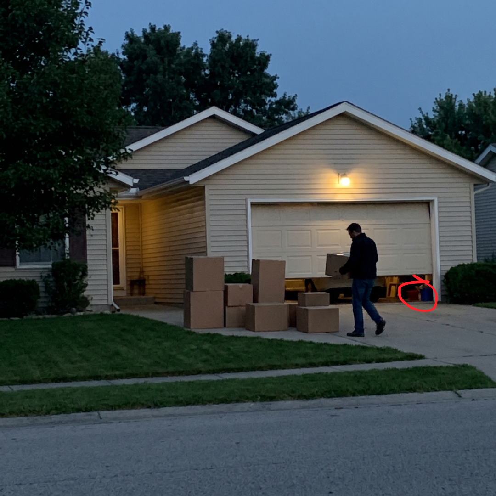

# 037 · USA Ready Families

- **Anuncio original:** [Meta · 1472645867645322](https://www.facebook.com/ads/library/?id=1472645867645322)
- **Página anunciante:** USA Ready Families · 1003452056175880
- **Destino observado:** [primitivelabsresearch.com](https://primitivelabsresearch.com/products/hydra-x1-portable-filtration-unit)
- **Categoría:** Hogar y preparación
- **Inicio publicado:** 2026-04-21 · 163 días de antigüedad.
- **Activo al consultar:** 2026-10-01T14:12:05.912606+00:00.
- **Ads activos globales de esa página:** aprox. 520 · [fuente](https://www.facebook.com/ads/library/?active_status=active&ad_type=all&country=ALL&media_type=all&search_type=page&view_all_page_id=1003452056175880).
- **Consulta geográfica:** [Estados Unidos](https://www.facebook.com/ads/library/?active_status=active&ad_type=all&country=US&media_type=image&q=my+wife&search_type=keyword_unordered).
- **Longitud del texto original:** 3200 palabras; el resumen de abajo es propio.

## Apertura breve del anuncio

> My neighbor's husband flew home from DC last month and started quietly moving his

## Qué desarrolla el copy

La narradora observa que un vecino del sector energético vende bienes, modifica planes familiares y acumula suministros. Una confidencia transforma esa conducta en advertencia sobre cortes y agua; el anuncio presenta Hydra-X1 con comparación entre reservas limitadas y filtración, garantía y urgencia de stock. Las supuestas confidencias, predicciones y prestaciones del filtro son alegaciones del anuncio, no hechos verificados en esta revisión.

## Qué muestra la imagen

Hombre con una carretilla frente a una vivienda de noche.

## Por qué encaja en el formato nativo

El registro informal de una tarea doméstica despierta curiosidad sin recurrir a envases ni a un titular de venta.

## Cómo adaptar la idea

Abrir con un cambio observable y real de conducta para explicar una compra útil. Conectar el producto con pruebas de uso y costos, sin fabricar amenazas ni recomendar fuentes de agua fuera de su certificación.

## Alcance de la verificación

Actividad, fecha publicada, consulta US, conteo de la página y formato revisados. No se verificó entrega continua, rentabilidad, autoría del testimonio ni los resultados que anuncia. El dominio de destino no demuestra propiedad de la página. 
