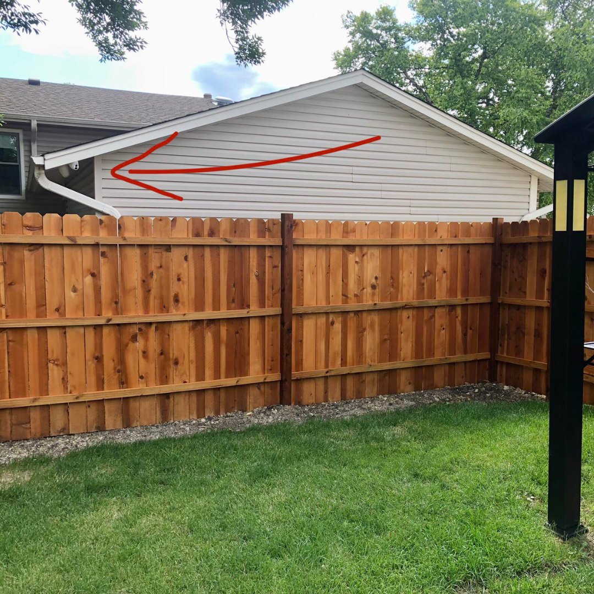

# 045 · USA Ready Families

- **Anuncio original:** [Meta · 1257344206612173](https://www.facebook.com/ads/library/?id=1257344206612173)
- **Página anunciante:** USA Ready Families · 1003452056175880
- **Destino observado:** [primitivelabsresearch.com](https://primitivelabsresearch.com/products/hydra-x1-portable-filtration-unit)
- **Categoría:** Hogar y preparación
- **Inicio publicado:** 2026-04-30 · 154 días de antigüedad.
- **Activo al consultar:** 2026-10-01T14:12:05.912606+00:00.
- **Ads activos globales de esa página:** aprox. 520 · [fuente](https://www.facebook.com/ads/library/?active_status=active&ad_type=all&country=ALL&media_type=all&search_type=page&view_all_page_id=1003452056175880).
- **Consulta geográfica:** [Estados Unidos](https://www.facebook.com/ads/library/?active_status=active&ad_type=all&country=US&media_type=image&q=my+wife&search_type=keyword_unordered).
- **Longitud del texto original:** 4977 palabras; el resumen de abajo es propio.

## Apertura breve del anuncio

> I figured out last Tuesday that I've been hand-delivering Top Secret military packages to

## Qué desarrolla el copy

Un repartidor dice haber entregado paquetes militares a un exfuncionario y descubierto su contenido por un embalaje roto. El misterio evoluciona hacia una supuesta crisis energética y la recomendación de Hydra-X1. El copy compara agua almacenada con acceso mediante filtración y añade garantía y escasez. Las supuestas confidencias, predicciones y prestaciones del filtro son alegaciones del anuncio, no hechos verificados en esta revisión.

## Qué muestra la imagen

Casa de un vecino con humo visible y una flecha superpuesta.

## Por qué encaja en el formato nativo

El encuadre doméstico con una anotación recuerda una publicación que señala algo inusual en el barrio, sin oferta gráfica.

## Cómo adaptar la idea

Construir curiosidad alrededor de un paquete o preparación real y mostrar qué problema resuelve su contenido. Evitar documentos secretos, identidades oficiales o plazos de crisis inventados; demostrar capacidades certificadas del producto.

## Alcance de la verificación

Actividad, fecha publicada, consulta US, conteo de la página y formato revisados. No se verificó entrega continua, rentabilidad, autoría del testimonio ni los resultados que anuncia. El dominio de destino no demuestra propiedad de la página. 
