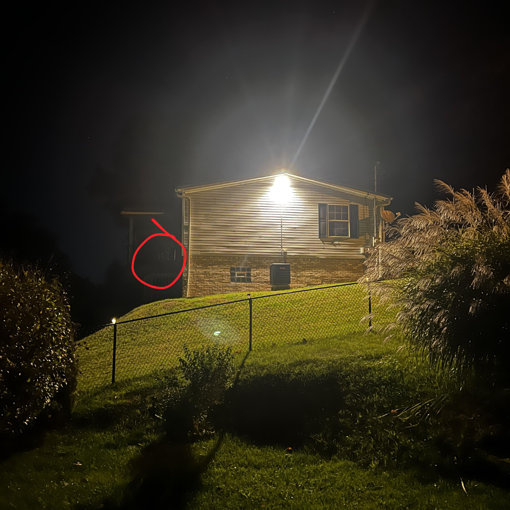

# 049 · USA Ready Families

- **Anuncio original:** [Meta · 985928827183533](https://www.facebook.com/ads/library/?id=985928827183533)
- **Página anunciante:** USA Ready Families · 1003452056175880
- **Destino observado:** [primitivelabsresearch.com](https://primitivelabsresearch.com/products/hydra-x1-portable-filtration-unit)
- **Categoría:** Hogar y preparación
- **Inicio publicado:** 2026-05-13 · 141 días de antigüedad.
- **Activo al consultar:** 2026-10-01T14:12:05.912606+00:00.
- **Ads activos globales de esa página:** aprox. 520 · [fuente](https://www.facebook.com/ads/library/?active_status=active&ad_type=all&country=ALL&media_type=all&search_type=page&view_all_page_id=1003452056175880).
- **Consulta geográfica:** [Estados Unidos](https://www.facebook.com/ads/library/?active_status=active&ad_type=all&country=US&media_type=image&q=my+wife&search_type=keyword_unordered).
- **Longitud del texto original:** 4152 palabras; el resumen de abajo es propio.

## Apertura breve del anuncio

> Last Sunday I was up at midnight with my insomnia when I looked out

## Qué desarrolla el copy

La narradora observa entregas nocturnas y preparativos en casa de un vecino. Él introduce una narrativa conspirativa sobre noticias como distracción y control de recursos, que termina en la compra de Hydra-X1. El cierre usa cifras cambiantes de inventario y urgencia extrema. Las supuestas confidencias, predicciones y prestaciones del filtro son alegaciones del anuncio, no hechos verificados en esta revisión.

## Qué muestra la imagen

Casa con luces encendidas de noche y un círculo de atención añadido.

## Por qué encaja en el formato nativo

La fotografía nocturna del vecindario crea una observación extraña propia de una historia social; el producto aparece solo en la argumentación.

## Cómo adaptar la idea

Usar un detalle cotidiano real como disparador de una explicación sobre autonomía o ahorro. Sustituir la conspiración por una necesidad demostrable y comunicar existencias o fechas únicamente si son verificables.

## Alcance de la verificación

Actividad, fecha publicada, consulta US, conteo de la página y formato revisados. No se verificó entrega continua, rentabilidad, autoría del testimonio ni los resultados que anuncia. El dominio de destino no demuestra propiedad de la página. 
