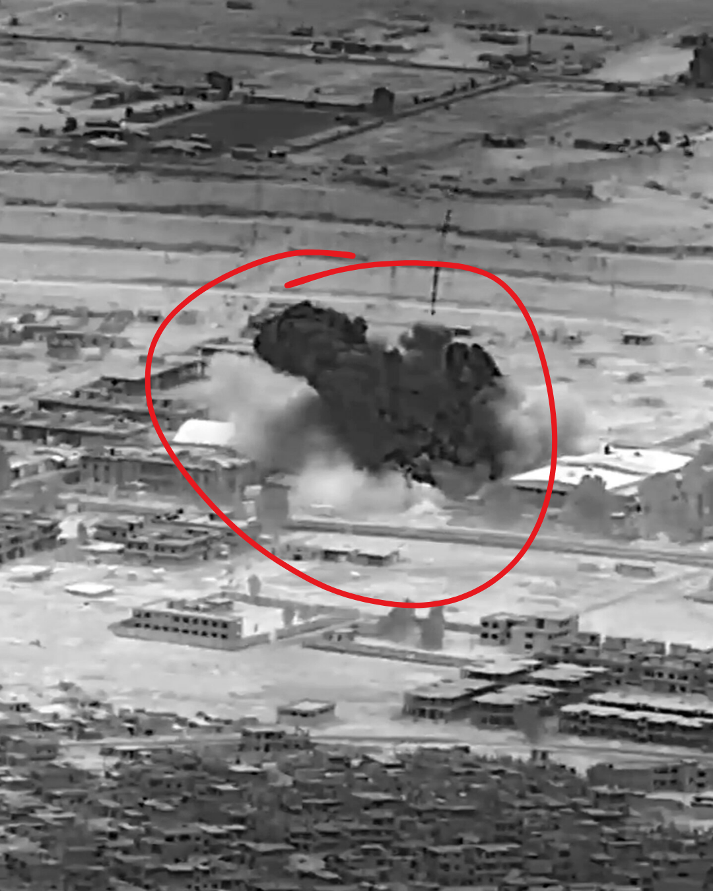

# 053 · USA Ready Families

- **Anuncio original:** [Meta · 1705762580874788](https://www.facebook.com/ads/library/?id=1705762580874788)
- **Página anunciante:** USA Ready Families · 1003452056175880
- **Destino observado:** [primitivelabsresearch.com](https://primitivelabsresearch.com/products/hydra-x1-portable-filtration-unit)
- **Categoría:** Hogar y preparación
- **Inicio publicado:** 2026-05-16 · 138 días de antigüedad.
- **Activo al consultar:** 2026-10-01T14:12:05.912606+00:00.
- **Ads activos globales de esa página:** aprox. 520 · [fuente](https://www.facebook.com/ads/library/?active_status=active&ad_type=all&country=ALL&media_type=all&search_type=page&view_all_page_id=1003452056175880).
- **Consulta geográfica:** [Estados Unidos](https://www.facebook.com/ads/library/?active_status=active&ad_type=all&country=US&media_type=image&q=I+thought&search_type=keyword_unordered).
- **Longitud del texto original:** 5569 palabras; el resumen de abajo es propio.

## Apertura breve del anuncio

> The man in the back seat of my Uber at Reagan two weeks ago

## Qué desarrolla el copy

Un conductor de Uber narra una supuesta conversación con un pasajero ligado al gobierno sobre el fracaso de conversaciones internacionales. El copy deriva de la amenaza energética a la dependencia del agua y presenta Hydra-X1 mediante demostración, comparación con botellas y presión de disponibilidad. Las supuestas confidencias, predicciones y prestaciones del filtro son alegaciones del anuncio, no hechos verificados en esta revisión.

## Qué muestra la imagen

Fotografía en blanco y negro de una escena de bombardeo o conflicto, con un círculo rojo añadido.

## Por qué encaja en el formato nativo

La imagen de archivo señalizada imita la ilustración de una noticia; no muestra el producto ni una oferta de catálogo.

## Cómo adaptar la idea

Usar una imagen contextual con fuente y fecha para explicar un problema real, luego mostrar una solución con límites técnicos claros. No presentar publicidad como noticia independiente ni inventar filtraciones gubernamentales.

## Alcance de la verificación

Actividad, fecha publicada, consulta US, conteo de la página y formato revisados. No se verificó entrega continua, rentabilidad, autoría del testimonio ni los resultados que anuncia. El dominio de destino no demuestra propiedad de la página. 
