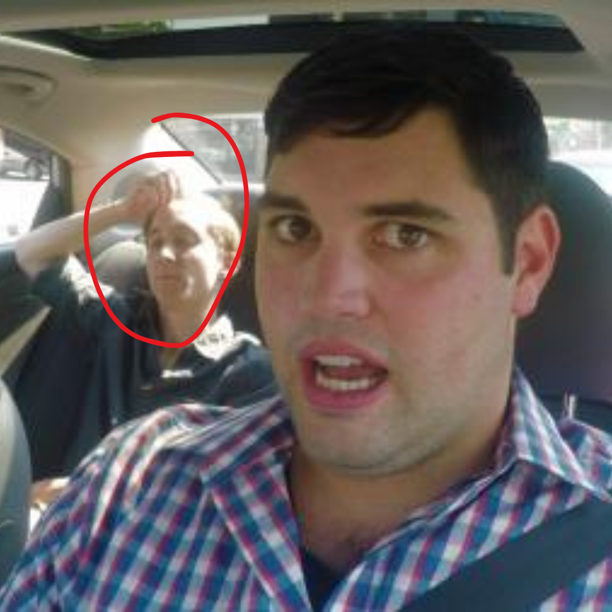

# 056 · USA Ready Families

- **Anuncio original:** [Meta · 946696811471619](https://www.facebook.com/ads/library/?id=946696811471619)
- **Página anunciante:** USA Ready Families · 1003452056175880
- **Destino observado:** [primitivelabsresearch.com](https://primitivelabsresearch.com/products/hydra-x1-portable-filtration-unit)
- **Categoría:** Hogar y preparación
- **Inicio publicado:** 2026-05-17 · 137 días de antigüedad.
- **Activo al consultar:** 2026-10-01T14:12:05.912606+00:00.
- **Ads activos globales de esa página:** aprox. 520 · [fuente](https://www.facebook.com/ads/library/?active_status=active&ad_type=all&country=ALL&media_type=all&search_type=page&view_all_page_id=1003452056175880).
- **Consulta geográfica:** [Estados Unidos](https://www.facebook.com/ads/library/?active_status=active&ad_type=all&country=US&media_type=image&q=my+wife&search_type=keyword_unordered).
- **Longitud del texto original:** 5569 palabras; el resumen de abajo es propio.

## Apertura breve del anuncio

> The man in the back seat of my Uber at Reagan two weeks ago

## Qué desarrolla el copy

Comparte el relato de el anuncio 1705762580874788: un conductor escucha una supuesta advertencia de un pasajero sobre energía y agua y termina recomendando Hydra-X1 para su familia. La selfie hace más concreta la escena inicial, pero no autentica al pasajero ni su historia. Las supuestas confidencias, predicciones y prestaciones del filtro son alegaciones del anuncio, no hechos verificados en esta revisión.

## Qué muestra la imagen

Selfie de un hombre dentro de un vehículo, con una persona del asiento trasero señalada por un círculo.

## Por qué encaja en el formato nativo

La foto parece tomada en el contexto de la anécdota del conductor. Mantiene el mismo copy de el anuncio 1705762580874788 y cambia de archivo noticioso a escena personal.

## Cómo adaptar la idea

Probar una imagen propia del contexto de uso frente a una ilustración editorial para un mismo argumento verificable. No identificar al fotografiado como funcionario ni atribuirle declaraciones sin evidencia y permiso.

## Alcance de la verificación

Actividad, fecha publicada, consulta US, conteo de la página y formato revisados. No se verificó entrega continua, rentabilidad, autoría del testimonio ni los resultados que anuncia. El dominio de destino no demuestra propiedad de la página. 
