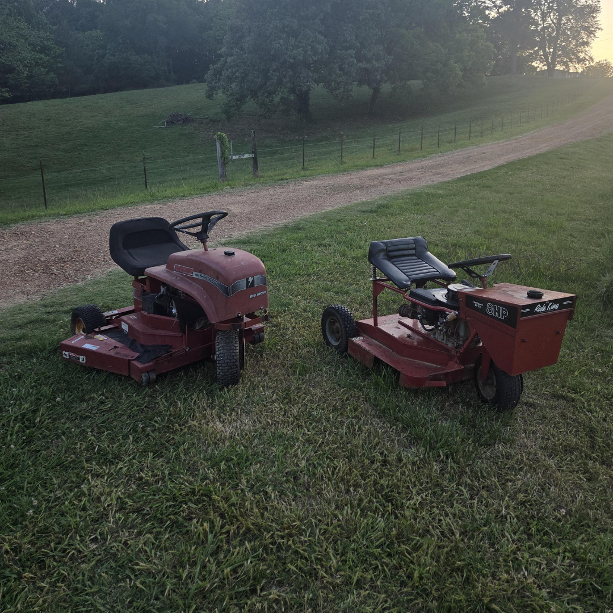

# 059 · USA Ready Families

- **Anuncio original:** [Meta · 1629782041584042](https://www.facebook.com/ads/library/?id=1629782041584042)
- **Página anunciante:** USA Ready Families · 1003452056175880
- **Destino observado:** [primitivelabsresearch.com](https://primitivelabsresearch.com/products/hydra-x1-portable-filtration-unit)
- **Categoría:** Hogar y preparación
- **Inicio publicado:** 2026-06-04 · 119 días de antigüedad.
- **Activo al consultar:** 2026-10-01T14:12:05.912606+00:00.
- **Ads activos globales de esa página:** aprox. 520 · [fuente](https://www.facebook.com/ads/library/?active_status=active&ad_type=all&country=ALL&media_type=all&search_type=page&view_all_page_id=1003452056175880).
- **Consulta geográfica:** [Estados Unidos](https://www.facebook.com/ads/library/?active_status=active&ad_type=all&country=US&media_type=image&q=my+wife&search_type=keyword_unordered).
- **Longitud del texto original:** 5675 palabras; el resumen de abajo es propio.

## Apertura breve del anuncio

> The man whose lawn I've cut for eleven years told me last Friday there's

## Qué desarrolla el copy

Un jardinero cuenta que un cliente, presentado como abogado del sector energético, le reveló una supuesta lista de prioridades durante cortes de luz. El relato encadena consumo eléctrico, pérdida de agua y preparación familiar para introducir Hydra-X1 de Primitive Labs; compara espacio y reserva de botellas con filtración portátil. Las supuestas confidencias, predicciones y prestaciones del filtro son alegaciones del anuncio, no hechos verificados en esta revisión.

## Qué muestra la imagen

Fotografía de cortacéspedes y equipo de trabajo de jardinería.

## Por qué encaja en el formato nativo

El material de un oficio cotidiano da contexto al narrador antes de introducir el producto; parece una historia personal del trabajo.

## Cómo adaptar la idea

Abrir con una experiencia real del oficio y una necesidad comprobable de preparación. Adaptar la comparación de almacenamiento y portabilidad con especificaciones reales; eliminar listas secretas y amenazas no sustentadas.

## Alcance de la verificación

Actividad, fecha publicada, consulta US, conteo de la página y formato revisados. No se verificó entrega continua, rentabilidad, autoría del testimonio ni los resultados que anuncia. El dominio de destino no demuestra propiedad de la página. 
