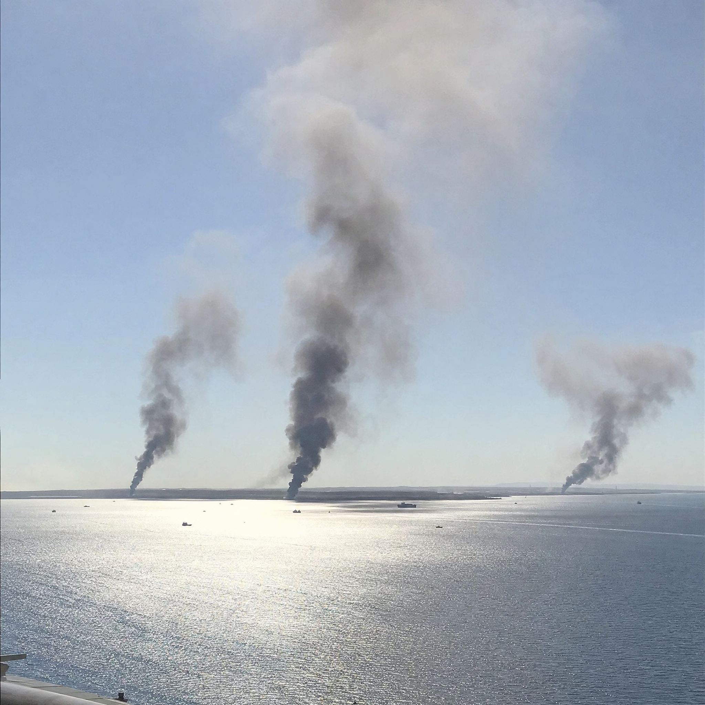

# 065 · USA Ready Families

- **Anuncio original:** [Meta · 1587789066359500](https://www.facebook.com/ads/library/?id=1587789066359500)
- **Página anunciante:** USA Ready Families · 1003452056175880
- **Destino observado:** [primitivelabsresearch.com](https://primitivelabsresearch.com/products/hydra-x1-portable-filtration-unit)
- **Categoría:** Hogar y preparación
- **Inicio publicado:** 2026-07-15 · 78 días de antigüedad.
- **Activo al consultar:** 2026-10-01T14:12:05.912606+00:00.
- **Ads activos globales de esa página:** aprox. 520 · [fuente](https://www.facebook.com/ads/library/?active_status=active&ad_type=all&country=ALL&media_type=all&search_type=page&view_all_page_id=1003452056175880).
- **Consulta geográfica:** [Estados Unidos](https://www.facebook.com/ads/library/?active_status=active&ad_type=all&country=US&media_type=image&q=my+wife&search_type=keyword_unordered).
- **Longitud del texto original:** 4297 palabras; el resumen de abajo es propio.

## Apertura breve del anuncio

> The deal with Iran fell apart and there was a brown padded mailer on

## Qué desarrolla el copy

Una mujer cuenta que su marido desplegado en el Golfo le envió un paquete inesperado. El relato conecta posibles ataques a infraestructura con cortes de agua y revela un filtro Hydra-X1 como la medida que él recomienda para la familia. Se apoya en una supuesta cadena de autoridad militar y compara el filtro con reservas agotables. Las supuestas confidencias, predicciones y prestaciones del filtro son alegaciones del anuncio, no hechos verificados en esta revisión.

## Qué muestra la imagen

Fotografía de humo sobre el mar.

## Por qué encaja en el formato nativo

La escena funciona como imagen editorial de un suceso exterior y no como una pieza de catálogo; su origen y fecha no fueron autenticados.

## Cómo adaptar la idea

Relacionar un problema real de preparación doméstica con una historia familiar auténtica y una demostración segura. No usar acontecimientos bélicos no verificados ni presentar agua sin analizar como potable.

## Alcance de la verificación

Actividad, fecha publicada, consulta US, conteo de la página y formato revisados. No se verificó entrega continua, rentabilidad, autoría del testimonio ni los resultados que anuncia. El dominio de destino no demuestra propiedad de la página. 
